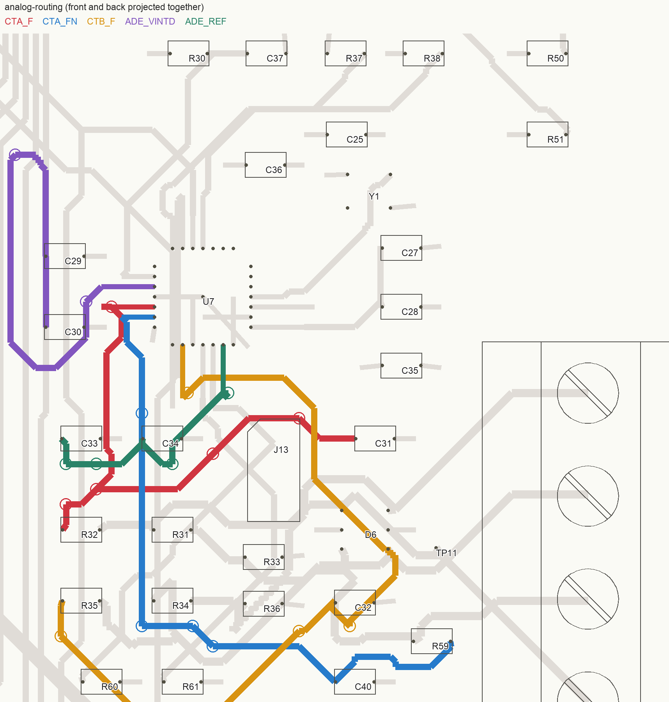
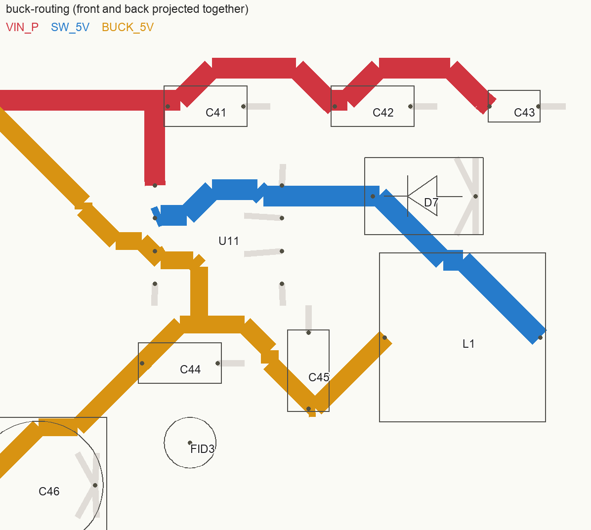

# PCB layout review - 2026-10-05

This document includes the PCB layout findings, component/rating findings
from the 13 newly mapped datasheets and exact Samsung bias curves, and the
recommended fixes, with sources and archived calculation evidence.

Reviewed `bisque-controller.kicad_pcb` and the ordered parts in
`jlcpcb/BOM.csv` on `main`, commit `99ca0d1`.
PCB SHA-256: `34244b4e1de67e028f5b7c51f59e57a39f6fffe08fcbecc3f4462f8844b54222`.
This review changed no circuitry, routing, footprints, firmware, or fabrication outputs.

## Verdict

The board is connected, passes its manufacturing geometry checks, and has
a consistent assembly package. I found no new PCB short, missing connection,
incorrect assembly rotation, or gross mechanical overlap. However, I would
improve the ADE7953 analog layout and buck switching loop before committing
to a production batch. Exposed-pad via processing also needs an explicit
assembly decision before ordering. The input-capacitor bias curves show
substantially less effective capacitance than the nominal bank implies;
buck stability, USB clamp coordination, watchdog timing, and repetitive
coil-flyback capability also require qualification or component changes.

This is a layout review, not a release of the kiln controller for service.
The electrical findings in
[the schematic review](SCHEMATIC-REVIEW-2026-10-05.md) remain applicable,
particularly input surge protection coordination, the SSR return-fault
path that bypasses the watchdog, the channel-A CT range, and the stacked
MOSFET fault case. A clean PCB DRC does not resolve those findings.

The board is unchanged from the full `make pcb-check` and native DRC runs
performed earlier in this chat. Those results were retained, and the new
work measured current routing, plane coverage, capacitor placement, signal
proximity, and mounting envelopes. A fresh native DRC on a temporary copy
with stricter solder-mask settings also passed.

## Findings

Findings 1-8 retain the original PCB-review numbering. Findings 9-12 cover
additional electrical issues confirmed or quantified by the added sources.
P1 requires resolution before deployment/production; P2 requires a design
decision, operating restriction, or qualification; P3 covers manufacturing
robustness, documentation, or assembled-board acceptance.

The Samsung PDFs are identical November 2015 family catalogs, rather than
part-specific bias curves. Exact manufacturer component pages supplied the
curve data used below. Those capacitances are **interpolated typical data
at the stated test conditions, not guaranteed minima or measured board
performance**. Proposed short-route distances and mechanical margins are
engineering goals, not manufacturer-mandated numerical limits.

### 1. [P2] ADE7953 bypass routing undermines the local capacitors

> **Status 2026-10-23:** done on the board. C36 (100 nF) is 1.0 mm from VDD pin 17 with its own +3V3 and GND vias; C35 (10 µF) sits 1.9 mm below it. `ADE_VINTD` is 9.4 mm of copper end to end (was 29.5), C30's pad 4.4 mm from pin 3, with the two caps stood on end west of U7. VINTA's C27/C28 are unchanged (~6 mm, an LDO output).

**Refs:** U7, C27-C30, C33-C36. **Region:** approximately x 85-107,
y 64-81 mm.

The strongest example is `ADE_VINTD`: U7 pin 3 to the 100 nF C30 is about
**29.5 mm of routed path through two vias**, despite just **5.7 mm of
straight-line pad separation**. It travels south on B.Cu, north to y 65,
then back south on F.Cu to C29/C30. The entire net contains 29.5 mm of
track. This is a regulator-output bypass connection with an unnecessary
large detour, not an ordinary digital signal.

Other examples are:

| Connection | Approximate routed path | Layer transitions | Direct pad separation |
|---|---:|---:|---:|
| U7.3 to C30.1, VINTD 100 nF | 29.5 mm | 2 | 5.7 mm |
| U7.13 to C34.1, REF 100 nF | 9.6 mm | 2 | 6.1 mm |
| U7.15 to C28.1, VINTA 100 nF | 7.0 mm | 0 | 6.6 mm |

C36's VDD pad is also about 7.0 mm directly from U7 pin 17, with its
connection carried through the +3V3 distribution. The capacitors exist and
connect correctly; their loop inductance and placement are the concern.
Analog Devices explicitly places the small ceramic bypasses closest to
the IC for high-frequency noise rejection. These routes provide less of
that benefit than their schematic symbols suggest.
[ADE7953 datasheet, layout guidance, page 68](https://www.analog.com/media/en/technical-documentation/data-sheets/ade7953.pdf).

**Recommended fix:** place C30/C34/C28/C36 immediately beside their U7
pins, with the small ceramics closest and C29/C33/C27 behind them. Aim for
approximately 1-3 mm pin-to-cap connections where package geometry allows.
Use direct F.Cu connections without signal-leg vias where practical, with
a ground via beside each capacitor's ground pad. Preserve the datasheet's
local AGND/DGND/exposed-pad connection on the continuous ground structure.
If 0805 parts prevent a compact placement, consider smaller ceramics for
these references rather than resizing the entire board's passives.

Reserve these routes before generic fanout and bus routing; the VINTD
detour should disappear. Recheck noise and current calibration with buck,
display, radio, I2C and aux loads active. This is a noise/immunity risk;
the geometry alone does not prove a failure.

### 2. [P2] Filtered CT inputs take long routes beside digital circuitry

> **Status 2026-10-23:** done. C31 and C40 stand on their side beside IAP/IAN (1.3 / 1.4 mm pad-to-pin), C32 beside IBP (0.6 mm). The 1 k / 5R1 resistors stay where they were, so the long run is now on the resistor side of each cap and the pin side is the short one. RXD0/TXD0, which walled the west side of U7, were re-routed to make room.

**Refs:** U7, R32/C31, R59/C40, R35/C32. **Region:** x 89-107,
y 72-92 mm.

| Filter capacitor to ADC pin | Approximate routed path | Layer transitions |
|---|---:|---:|
| C31.1 to U7.5, `CTA_F` | 26.7 mm | 4 |
| C40.1 to U7.6, `CTA_FN` | 27.6 mm | 4 |
| C32.1 to U7.9, `CTB_F` | 25.1 mm | 2 |

These are the sensitive nodes after the series filter resistors. The
channel-A negative input has a particularly concrete coupling exposure:
`CTA_FN` runs vertically on B.Cu at x 92.00 from y 77.75 to 88.25, next to
`I2C_SCL` at x 92.75. Both tracks are 0.30 mm wide: **10.5 mm parallel
overlap with a 0.45 mm copper-edge gap**. That geometry passes clearance
DRC, but gives a digital clock a long adjacent analog victim. Noise picked
up after the filter is not equivalent to noise arriving at the CT terminal.

The current path measurements supersede older route lengths in the
September review. They still justify a layout improvement. The ADE7953
requires input antialias filtering; keeping the shunt capacitors at the ADC
also minimizes the exposed filtered-node length.
[ADE7953 datasheet, antialias filter discussion, page 20](https://www.analog.com/media/en/technical-documentation/data-sheets/ade7953.pdf).

**Recommended fix:** place C31/C40/C32 and their associated series
resistors near U7 pins 5/6/9. Aim for filtered connections of only a few
millimetres, preferably entirely on F.Cu, with short local ground returns.
Keep the burden resistors and cable protection near J12; route the longer,
protected raw CT signals to the local ADC filters. Route the analog nodes
first, then take SCL/SDA around this area and remove their long parallel
overlap with CTA_FN. Keep differential filter geometry balanced where the
circuit calls for it; nanosecond length matching is unnecessary here.

Resolve the channel-A electrical range and input balancing before fixing
the final layout. Verify zero-current noise and current calibration with
switching, radio, display, I2C and aux loads active.

Figure: colored copper is measured from the board. Front and back are
projected together; crossings in this drawing do not imply shorts. Planes
are omitted. Purple shows the VINTD detour; blue shows the filtered
channel-A negative input. The gray routes include the adjacent digital bus.

### 3. [P2] Buck layout, capacitor selection and current margin need improvement

**Refs:** U11, D7, L1, C41-C43. **Region:** x 101-118, y 98-111 mm.

`SW_5V` contains **18.0 mm of 0.8 mm track and two vias**. The path from
U11 pin 2 to D7's cathode is about **9.0 mm**, changes to B.Cu at
(105.25, 101.75), and returns to F.Cu at (108.75, 102.00). The same net
then reaches the inductor. This is a switching-current node, so a wide
track with two layer transitions is not interchangeable with a compact
switch/diode junction.

The nearest input bulk capacitor, C41, is reasonably near the VIN pin;
C43's 100 nF pad is **13.4 mm away directly**, with about 18.4 mm of route
to VIN. The input-capacitor ground, catch-diode ground, and IC ground
should be considered as one high-frequency current loop. A continuous
inner GND plane helps, but does not remove the extra switched-node area
or the via inductance.

XL Semiconductor's reference circuit asks for short heavy-current
connections, ground-plane construction, and feedback wiring kept away from
inductor flux. The concern here is EMI, switch overshoot, and noise coupled
into the nearby current-sense section, rather than a demonstrated DC fault.
[XL1509 datasheet, design guidance, page 7](https://www.xlsemi.com/datasheet/XL1509-CN.pdf).

**Recommended layout fix:** rebuild U11/D7/L1/input ceramics as a compact
F.Cu cluster. Put D7's cathode beside U11's switch pin and L1's switch-side
terminal at the same compact junction. Eliminate the switch-node layer
changes and minimize switched copper area. Keep the input-capacitor and
catch-diode ground connections short and wide; avoid routing the IC's quiet
ground connection through a diode-current track. Take feedback from the
quiet output-capacitor node, away from the switch node and inductor flux.

Settle the actual input/output capacitor network and current budget below
before freezing placement. A redesign using a buck explicitly qualified
for ceramic outputs is preferable to relying on an undocumented C46 ESR
assumption. If retaining XL1509, use supporting impedance data and qualify
the complete network. Validate switching overshoot with a short probe
ground, rail ripple, startup, light/full load, load steps, cold/hot operation
and current-sense noise. Resolve finding 9's protection mismatch first.

Figure: red is protected 24 V, blue is the switch node, and gold is the
buck output. Both outer layers are projected together and GND is omitted;
this illustrates placement and routing, not the complete current loop.

#### Effective input capacitance

**Refs:** C41/C42, U11. **Source:** S7, Samsung's exact 10 uF component page.

The ordered part is CL31A106KBHNNNE, 10 uF/50 V X5R in 1206. The family
catalog confirms its nominal value, voltage, tolerance, and dimensions.
Its exact Samsung bias curve gives:

| Applied DC bias | Typical loss | Typical capacitance per part | C41 + C42 |
|---|---:|---:|---:|
| 24 V | 86.5% | 1.35 uF | 2.70 uF |
| 26.4 V | 88.3% | 1.17 uF | 2.34 uF |

The curve is at 25 C, 1 kHz, 1 Vrms. The actual rail ripple, frequency,
temperature, aging, and purchase tolerance differ from that test. The 50 V
rating is a voltage-withstand specification; it does not preserve 10 uF
at the operating voltage.
[Samsung CL31A106KBHNNN component data](https://product.samsungsem.com/mlcc/CL31A106KBHNNN.do).

There are only three capacitors on VIN_P: C41, C42, and the 100 nF C43.
Consequently the local input bank is closer to 2.8 uF than 20.1 uF at 24 V
under these typical conditions. This worsens the significance of the
remote bypass/hot-loop routing described above.

For scale, an ideal 24-to-5 V buck at 1 A, 150 kHz, with all pulsed input
current supplied by that 2.8 uF bank gives approximately **0.39 V peak-to-peak**
capacitor ripple from `Iout * D * (1-D) / (f * Cin)`. That is a conditional
screening estimate, not a prediction of measured ripple: the PSU, wiring,
capacitor impedance, switch losses, and inductor ripple affect the result.
XL1509's test/application circuits use much larger input capacitance, but
those examples are not a universal minimum for this board's load.

**Action:** choose input capacitance by its effective value at 24-26.4 V
and the intended temperature, not its nominal value. Consider a verified
ceramic selection plus suitable bulk capacitance; qualify cable hot-plug
ringing, inrush, ripple, and maximum-load operation. Keep the ceramic loop
local to U11. This is an avoidable margin problem, not an observed brownout.

#### Output-capacitor stability remains unqualified

**Refs:** C44-C46, L1, U11. **Sources:** S2, S6, S9.

The exact RoQang RVT series sheet confirms C46's 100 uF/16 V, +/-20%,
5 x 5.4 mm selection. It does **not** specify the generator comment's
0.5-1.5 ohm ESR range at the relevant frequencies, nor a minimum ESR.
It gives a maximum dissipation factor of 0.20 at 120 Hz/20 C. At nominal
100 uF, converting that gives about 2.65 ohm; that is not an ESR specification
at 2 kHz or 150 kHz, and the capacitance tolerance also changes the conversion.

The 100 uF/16 V, 5 x 5.4 mm row permits **48 mA rms at 120 Hz/105 C**,
rather than the comment's rounded 50 mA. Its general frequency multipliers
stop at 10 kHz. The claimed 6 mA share of switching ripple cannot be
established without the branches' actual frequency-dependent impedances.

C44/C45 also differ from the comments' assumed 32 uF combined after bias:
the exact 22 uF part's typical curve gives **13.65 uF each at 5 V**, or
about **27.3 uF combined**, before additional conditions/tolerances.
An added electrolytic can provide useful damping, but parallel ceramics
mean the complete network must be analyzed; applying one ESR-zero formula
to C46 alone does not establish the regulator's phase margin.

XL1509 Rev 2.0 page 9 specifies example 5 V/2 A designs with 68 uH and
particular 180 uF electrolytics or tantalums for inputs up to 20/40 V.
The present 47 uH and mixed output network is different. Those examples
do not prove this lighter-load implementation is unstable, but neither do
they qualify it. Page 8's low-ESR discussion does not give a guaranteed
stability envelope for the present network.

**Action:** obtain impedance/ESR data over frequency and temperature for
the selected C46, or use a documented capacitor/regulator combination.
Measure startup, no/light/full load, load steps, and cold/hot behavior.
Remove the unconditional claim that C46 makes the rail stable until there
is supporting analysis and assembled-board evidence.

#### L1 current and thermal margin

S8 gives FXL0650-470-M: 47 uH +/-20%, 230 milliohm maximum DCR,
2.08 A in the `Isat MAX` column / 2.6 A typical, and 1.5 A / 2.0 A
heating currents. The notes define 2.08 A as the approximately **30%
inductance-drop** point, 1.5 A as a **20 C rise** test, and 2.0 A as a
**40 C rise** test, referenced to 25 C. These are not a guarantee of
constant 47 uH up to 2 A or universal hot-enclosure capability.

At 26.4-to-5 V, 1 A, using 37.6 uH and XL1509's 127 kHz lower frequency
gives an ideal 0.849 A peak-to-peak ripple and **1.424 A peak**. This is
a useful screen below the listed 30%-drop current, not a worst-case proof:
it excludes additional DC-bias/temperature inductance loss and switch/diode
effects. At 2 A output the same calculation gives 2.424 A peak, above the
listed 2.08 A point. Do not infer a qualified 2 A rail from U11's or L1's
headline rating. Copper loss alone is about 0.23 W at 1 A rms before
temperature and AC/core loss; verify part temperature stays below 125 C.

**Action:** specify the maximum simultaneous buck load and enclosure
ambient, then qualify ripple, peak current and L1 heating at that operating
point. Replace the inductor if that budget exceeds its verified margins;
do not advertise a 2 A system rating from the regulator's headline alone.

### 4. [P2] Exposed-pad vias require a defined reflow process

**Refs:** U1 pad 41, U2 tab/pad 2, U7 pad 29.

The earlier direct KiCad geometry audit remains valid: **17 exposed-pad
vias** intersect paste apertures, comprising U1's nine, U2's four, and U7's
four. The board declares front/back tenting, but declares no via filling or
capping. An exposed pad's mask opening exposes the top of a via within it;
the general tenting setting is not a filled barrel.

The via-in-pad checker intentionally permits these thermal/ground grids.
Its pass is therefore not evidence that solder wicking, voiding, or EP
joint quality has been qualified. U7's ground pad matters electrically as
well as thermally. The vias themselves are beneficial and should not simply
be removed to quiet a manufacturing warning.

**Recommended fix:** specify epoxy-filled, copper-capped via-in-pad
processing for the affected U1/U2/U7 pads, retaining the beneficial thermal
and ground vias. Record the process explicitly in the fabrication notes
and order options; changing the general tenting setting is insufficient.

If avoiding that fabrication cost, move U2's vias outside its paste area
and obtain assembler approval of the U1/U7 via and segmented-stencil
arrangement. Segmented paste alone does not qualify open barrels. Require
EP joint inspection and functional acceptance on prototypes; inspecting
the package perimeter cannot verify a hidden QFN EP joint.
[JLCPCB via-covering processes](https://jlcpcb.com/help/article/pcb-via-covering).

> **Status 2026-10-26:** done on the board, no fab-side process needed. **U1:** the nine generator-placed vias in the paste windows are deleted; the KiCad library footprint's twelve bottom-tented 0.3 mm web holes remain. **U2:** the four tab vias moved 0.9 mm outside the tab into the masked +3V3 pour. **U7:** the stencil is four 1.1 mm windows on a 0.7 mm cross (50 % coverage), the pad's own mask opening is replaced by four 1.2 mm apertures over those windows, and the four GND vias (0.5/0.3) sit on the cross under the mask web, i.e. tented. Zero vias remain under paste. Details in DESIGN-NOTES §U1, §U2, §U7.

### 5. [P2] Many SPI transitions have distant return-path structures

The stack is F.Cu / In1 GND / In2 +3V3 / B.Cu. Thus the nearest solid
reference changes from GND to +3V3 when a signal changes outer layers.
Both inner planes have a single stored filled contour and are broadly
continuous. I found no large reference-plane gap in the sampled critical
routes; the concern is reference transfer at vias.

Current geometry:

| Net | Signal vias | GND via within 1.5 mm | +3V3-to-GND bypass centre within 3 mm |
|---|---:|---:|---:|
| SPI_SCLK | 11 | 0 | 0 |
| SPI_MOSI | 10 | 1 | 0 |
| SPI_MISO | 13 | 0 | 0 |
| LCD_SCLK_R | 1 | not used as the primary metric | 0 |
| LCD_MOSI_R | 1 | not used as the primary metric | 0 |

The nearest bypass to several transitions is tens of millimetres away.
A ground via alone does not connect GND to a power-plane reference:
appropriate nearby bypass capacitance, fewer transitions, or routing
referenced to the same grounded structure is needed. Same-layer ground
pours and distributed plane capacitance offer additional return paths;
the distance counts are screening measurements, not an electromagnetic
simulation or proof that the bus fails.
[TI explanation of GND-to-power reference transitions](https://www.ti.com/video/6307562268112).

The LCD is configured at 40 MHz. Its 33-ohm resistors at the J5 end are
useful cable damping, but they are not located at the ESP32 source and do
not eliminate the long shared-bus branches and their transitions.

**Recommended fix:** retain the existing stack initially and route the
main clock/MOSI runs on F.Cu over the GND plane, reducing avoidable vias
and branch lengths. At remaining F-to-B transition clusters, provide local
+3V3-to-GND reference-transfer capacitors with short vias to both planes.
Small 10-100 nF ceramics are starting candidates; place them as close as
practical, targeting roughly 1-2 mm from the transition. A GND via alone
does not bridge these two reference planes.

Add source-series-resistor footprints near the ESP32 clock/MOSI drivers,
before the branches. Start tuning around 22-47 ohm and select actual values
from receiver waveforms. Evaluate the existing connector-side 33-ohm
resistors with that network rather than blindly stacking resistance. MISO
damping, if required, belongs near its driving slave, not at the ESP32
input. Minimize stubs and verify display SDO is high impedance when
deselected. Scope receiver waveforms at the 40 MHz display setting with
the actual loom and all SPI devices fitted; edge rate also matters.
[TI high-speed layout guidance](https://www.ti.com/lit/an/scaa082a/scaa082a.pdf).
EMI qualification remains required before calling the layout production
proven.

### 6. [P2] Power-mux bypass placement and USB clamp coordination need improvement

> **Status 2026-10-23:** the input-capacitor half is done: C47 is 0.5 mm from VIN2, C48 0.7 mm from VIN1, each with a GND via. The USB clamp coordination part is untouched.

**Refs:** U12, C47, C48, C1. **Region:** x 45-58, y 29-40 mm.

C47/C48 fix the earlier absence of input capacitance. They do not make the
connections local to U12:

| Connection | Approximate routed path | Direct pad separation |
|---|---:|---:|
| U12.6/VBUS to C47.1 | 11.3 mm | 6.0 mm |
| U12.3/BUCK_5V to C48.1 | 12.6 mm, two layer transitions | 7.1 mm |
| U12.7/VOUT to C1.1 | not used as a route measurement | 11.7 mm |

The buck bulk capacitance at C44 is about 98 mm of routed path from
U12's VIN1 pin. C48 therefore does useful work, but its trace and ground
loop still affect hot-plug and switchover behavior. TI requests input and
output capacitors close to the device and short, wide power connections.
[TPS2116 datasheet, layout guidance, page 17](https://www.ti.com/lit/ds/symlink/tps2116.pdf).

**Recommended fix:** move C47/C48 beside U12's respective input pins,
using short, wide F.Cu connections and nearby ground vias. Reposition the
divider resistors or surrounding parts if needed to create a local pocket.
Add dedicated output capacitance beside U12 VOUT while retaining C1 near
U2's LDO input. Select the local ceramic and any bulk capacitance for
handover droop, reverse-current-blocking transients and USB inrush together.
As a first hold-up estimate, use `C >= Iload * handover_time / allowed_droop`,
with effective capacitance at operating voltage and temperature. Adding a
small bypass alone does not establish uninterrupted operation.

Qualify USB insertion, 24 V removal/restoration with USB attached, slow
input ramps and maximum simultaneous WiFi/display load at U12 and U1.
Also resolve the rail-clamp coordination below; relocating capacitors alone
does not close that rating issue.

#### Local rail capacitance and hold-up budget

The BOM uses this same capacitor at C1 and C3 despite their `22uF/25V`
value labels. Typical bias screening gives C1 about 13.65 uF on +5V and
C3 about 17.49 uF on +3V3. C3 still comfortably exceeds the LV regulator's
nominal 1 uF minimum, so this is not a newly demonstrated LDO stability
failure. It affects the transient/hold-up budget. At the reviewed snapshot, the datasheet
manifest lists C38/C44/C45 but omits C1/C3 from this part's references;
resolve that alias in the documentation mapping.

#### USB rail-clamp coordination

**Refs:** U4, U12, U2. **Source:** S3; existing TPS2116/TLV1117LV sheets.

The selected Hongjiacheng SRV05-4, C7420376, has a 5 V reverse working
rating, **6 V minimum breakdown at 1 mA**, and **13.5 V typical / 15 V
maximum clamp at 4 A, 8/20 us**. U4's VP pin is connected to VBUS and
its VN pin to GND. U12 VIN2 is connected directly to that same VBUS rail.
TPS2116's input absolute maximum is **6 V**, with 5.5 V recommended maximum.

Thus the comment that U4 clamps transients so U12 is safe is not supported.
Normal USB operation is a separate question and is not shown to exceed
the rating here. A part's own +/-30 kV ESD survival is also not a guarantee
of the protected board's survival, and the quoted 8/20 us clamp is not an
IEC ESD waveform measurement at U12. U2's 6 V absolute maximum can matter
if the transient propagates through the mux.

**Action:** define the required USB surge/ESD conditions and coordinate a
protection network with the protected ICs, including local capacitance,
current limiting/impedance or surge-tolerant power switching as appropriate.
Verify the actual waveform at U12. Do not treat a nominal "5 V TVS" as a
5 V maximum clamp.

D5/D6 use the same array. The new sheet confirms the earlier warning:
rail steering plus the connector-side topology does not qualify a 24 V
sensor miswire or ensure the ADE7953's 2 V analog-input absolute maximum.
Those existing findings stay open.

### 7. [P3] Cold-junction accuracy and thermal loading need assembled-board evidence

U3/U5 centres are approximately **17 mm from their respective terminal-pad
centres**, rather than a few millimetres. Those pads are a proxy: the actual
dissimilar-metal junction is inside each terminal. The buck and LDO are
well separated from the thermocouple ICs, which is helpful, and the two
channels' present geometry is similar. It still does not establish equal
connector and IC temperatures during warm-up or enclosure airflow changes.

The MAX31856's internal temperature sensor must track the cold junction.
Its nearby supply bypasses also have about 6-10 mm direct pad separation
from the respective IC supply pins. Improve those connections if the
thermocouple block is re-placed, while preserving the intentional mirrored
digital arrangement.
[Analog Devices cold-junction placement guidance](https://ez.analog.com/data_converters/a/documents/c/max31856-faq/DO12492/where-is-the-optimal-position-to-place-the-max31856-for-accurate-cold-junction-compensation).

**Recommended fix:** move each MAX31856 closer to the connector's actual
metal junctions, respecting the connector body and mating envelope and
preserving the intentional mirrored digital arrangement. Treat each
connector and IC as one thermal region, away from local heat sources or
uneven airflow. Bring its supply bypass closer with a short ground return.

Spread U2's heat using appropriate +3V3 tab copper and additional thermal
vias outside paste areas or with filled/capped processing. Measure the
resulting temperature rather than assuming copper guarantees sufficient
margin. If maximum-load/ambient tests remain too hot, reduce LDO loss by
changing the power architecture.

**Acceptance:** measure terminal temperature and thermocouple error through
warm-up with radio/display/buck/aux loads active, in the intended enclosure.
Check U2, U11, D7, L1, and U6 at the maximum simultaneous load and ambient.
U2's four vias correctly join its +3V3 tab to the +3V3 plane; this is useful
thermal copper, not permission to tie its tab to GND. LDO dissipation is
about 0.85 W at 500 mA from 5 V to 3.3 V, before quiescent contributions.
That is a thermal test condition, not a prediction of this board's junction
temperature. Require margin to each part's operating-temperature limits.

### 8. [P3] Specify the mounting hardware envelope at H4

> **Status 2026-10-23:** done. C41/C42/C43, D7 and L1 moved 1.5 mm north; L1's courtyard clears an 8 mm washer on H4 by 1.4 mm.

H4 is at (115, 115). L1's nominal F.Fab outline reaches y 110.8. An
**8 mm OD washer leaves only 0.2 mm nominal clearance** to the inductor;
a 9 mm OD washer overlaps the outline by 0.3 mm. Placement, body, hole,
and washer tolerances have not been included in that nominal 0.2 mm.

The S8 catalog specifies L1 as 7.0 +/-0.3 by 6.6 +/-0.2 mm, with 5 mm
maximum height. At its current orientation, the larger permitted body
width reduces the 8 mm washer clearance to about **0.1 mm before placement,
hole or washer tolerances**.

**Recommended fix:** move L1 approximately 1-2 mm north during the buck
cluster revision, subject to placement and routing checks. Add a mechanical
keepout/check covering the screw-head and washer envelope plus tolerances,
targeting roughly 1 mm worst-case body clearance. If retaining the current
placement, explicitly restrict H4's head/washer envelope, preferably to
7 mm OD or less, and verify the physical fit before tightening. A 7 mm
washer has about 0.7 mm nominal clearance, not a tolerance-qualified
guarantee. The other holes have substantially more body clearance. An
8 mm washer screening found no foreign-net exposed pad in its envelope
at any mounting hole.

### 9. [P1] Input surge protection is not coordinated with component ratings

**Refs:** D8, U11, D7, F1. **Sources:** S1/S2/S4/S5.

S1 explicitly confirms D8's 48.4 V clamp at 8.3 A, 33.3-36.8 V breakdown,
and 400 W **10/1000 us non-repetitive pulse** rating. S2 confirms U11's
40 V operating / 45 V absolute maximum. S5 confirms D7's 40 V reverse
rating. The existing mismatch is unchanged and now backed by the exact
added sheets. The TVS's 1 W steady-power figure assumes an infinite heat
sink; it does not qualify the sustained-fault example in the first review.

**Action:** define the permitted supply, cable and fault conditions and
coordinate the protection network with U11/D7 and F1 over those conditions.
Select clamping and protected-device ratings together, including tolerance,
surge current and energy, and sustained-fault behavior. Verify voltage at
the protected parts. A shorter buck loop cannot repair this rating mismatch;
the schematic review's input-protection finding remains open.

> **Status 2026-10-27:** see the schematic review's item 1 status. Envelope
> defined at F1 in `DESIGN-NOTES.md`; D7 → SS36 (60 V), D9/D10 → 1N4007W
> (1 kV); D8 stays SMAJ30A because the supply trims to 29 V.

### 10. [P2] F1's operating-current and temperature budget needs qualification

**Refs:** F1, buck input and both SSR/coil outputs. **Source:** S4.

S4 confirms 0.75 A hold / 1.5 A trip at 25 C and 33 V maximum. The
explicit trip-time test is **0.20 s at 8 A**, not a guarantee of fast
clearing at 1.5 A or a current-limited overvoltage. Its 0.09 ohm value is
the minimum initial resistance; the listed post-reflow R1 maximum is
0.45 ohm. At 0.65 A, those endpoints correspond to about 0.059-0.293 V
drop and 0.038-0.190 W. They are not a complete resistance-versus-temperature
model and must not be treated as a single 90 milliohm nominal part.

The family derating table lists the `JK-mSMD075` row at **0.49 A at 60 C,
0.45 A at 70 C, and 0.35 A at 85 C**. It does not provide a separate
`-33` derating row, so confirm applicability with Jinrui rather than silently
claiming suffix-specific guarantees. That guidance is already below the
comments' approximately 0.25 A buck input plus 0.40 A two-coil budget at
60 C. Low-current SSR inputs may fit; the advertised contactor allowance
needs a temperature-aware budget. Increasing F1 without recoordinating
fault protection is not a complete repair.

**Action:** establish the simultaneous load and enclosure-temperature
budget using applicable hold-current derating and resistance limits.
Restrict coil loading or change the coordinated protection design if that
budget is exceeded. Do not merely enlarge F1 without checking fault energy
and the remaining protection components.

### 11. [P2] Watchdog capacitor data do not support the stated timeout window

**Refs:** C38/R46/U10, and the same purchased capacitor at C1/C3/C44/C45.
**Source:** S6; exact Samsung component data.

CL31A226KAHNNNE is correctly 22 uF/25 V, +/-10%, **X5R (-55 to +85 C)**,
1206. It is not a precision timing capacitor. At 25 C, 120 Hz, 0.5 Vrms,
Samsung's typical curve shows about **20.5% loss at 3.3 V**, corresponding
to 17.49 uF. That already exceeds the generator's 15% allowance for bias
and temperature at that bias point.
[Samsung CL31A226KAHNNN component data](https://product.samsungsem.com/mlcc/CL31A226KAHNNN.do).

C38 is a timing capacitor between U10's timing pins, not a capacitor held
at a constant 3.3 V. Its nonlinear capacitance must be considered over the
actual charge/discharge waveform. Multiplying the nominal timeout by 0.795
is therefore not a correct substitute for characterizing the one-shot.
The generic X5R temperature classification and typical bias curve also do
not guarantee the previously quoted 1.65-2.71 s window, particularly with
tolerance and aging. The original TI timing-extrapolation finding remains.

**Action:** qualify the total timeout over temperature, rail, capacitor
variation/aging, and held-high/held-low kicks, or select a timer with a
specified accuracy. Record the resulting guaranteed/qualified interval.
The data suggest more loss than assumed; they do not establish the actual
expiration time on this PCB.

### 12. [P2] Coil-flyback capability lacks a specified repetitive rating

**Refs:** D9/D10; also D3/D4. **Source:** S10.

The ordered Semtech Electronics 1N4148W, C81598, specifies **150 mA average
rectified current** at 25 C and non-repetitive surges of 0.5 A for 1 s,
1 A for 1 ms, and 4 A for 1 us. It does not specify the generator comment's
450 mA repetitive-peak rating.

That distinction matters because J4/J9 are documented as supporting roughly
200 mA contactor coils as well as SSR inputs. On interruption, the diode
starts at the coil current and decays with the actual coil inductance,
resistance, and diode drop. A 150 mA average rating does not automatically
forbid a 200 mA decaying pulse, but non-repetitive surge ratings cannot
qualify arbitrary repeated coil operation either.

**Action:** specify allowed coil inductance/current, switching frequency,
ambient, and turn-off delay, and qualify the pulse/average heating; or use
a flyback part with suitable repetitive ratings. Preserve the independent
heater cutoff. Ordinary resistive SSR inputs do not create this flyback
stress. D3's LED supply and D4's buzzer must be checked at their actual
currents; this sheet alone introduces no demonstrated normal-use failure
for those two parts.

> **Status 2026-10-26:** D9/D10 are B5819W (JSCJ C8598, Basic: 1 A average, 9 A surge, 40 V) in the same SOD-123 land, so no copper moved. The SS34 was tried first and does not fit the SSR column (DESIGN-NOTES §D9). D3/D4 stay 1N4148W at their LED/buzzer currents.

## Manufacturing, mechanical, and verification checks

| Check | Result / interpretation |
|---|---|
| Board | 100 x 100 mm, four copper layers, 1.6 mm declared thickness |
| Inventory | 182 footprints, 1783 track segments, 490 standalone vias |
| Native copper DRC | 0 violations and 0 unconnected items on the unchanged board |
| New stricter mask check | 0 violations/0 unconnected with 0.10 mm mask-groove minimum and 0.05 mm mask-to-copper clearance; command used `--exit-code-violations` |
| Full unmodified `make pcb-check` | Passed outside the macOS sandbox earlier in this chat; unchanged board |
| Drill geometry | 598 apertures, minimum measured web 0.300 mm; slots included |
| Courtyards | Every footprint has a courtyard; native/custom overlap checks pass |
| SMD via encroachment | No non-exempt overlaps; intentional EP grids remain finding 4 |
| USB | F.Cu only, zero vias, checker pad-to-pad lengths 25.09/22.57 mm, skew 2.52 mm; no need to add meanders for this full-speed interface |
| Inner planes | One stored filled contour each for GND and +3V3; no sampled critical-route reference gap >=0.7 mm after excluding the signal's own via/PTH antipads |
| Assembly placement | Earlier 147-placement/46-LCSC-land-pattern fit passes; special origins and rotations retained |
| Silkscreen | Existing checks report no pad-window overlap, off-board text, text collision, or text hidden under bodies; 0.8 mm labels still need physical legibility verification |
| Current outputs | Fresh Gerber/drill and CSV comparisons from the schematic review match the committed order package; ZIP matches its 14 source files |
| Mechanical access | Edge-facing screw terminals, accessible reset/boot, external-antenna module, and keyed loom headers are sensible; actual mating plugs, coax, screwdriver, enclosure, and strain relief still need a physical fit check |
| Hand assembly | Package omits the documented 13 hand-fitted parts, including LED1; fit and inspect them after SMT reflow |
| Native parity | Completed outside the sandbox with 513 name/field/attribute findings; see schematic review. Copper DRC cleanliness is not native parity cleanliness |

The mask checks currently disabled in the real project can be enabled at
the tested settings without changing current copper or mask output. Five
other native categories are ignored by the project, including missing
courtyards and off-centre via endpoints; the independent courtyard scan
found no missing courtyard on this board.

Ordering must explicitly select the declared **JLC04161H-7628** stack,
four layers, 1.6 mm, and **ENIG**, and settle finding 4's via processing.
The USB impedance estimate depends on that press; changing prepreg is not
equivalent. Confirm the assembler's handling/panel arrangement around the
edge USB connector and nearby parts, and inspect its final BOM/CPL preview.
Gerber metadata alone does not choose every order-form option.

The PCB contains low-voltage control circuitry. Its copper clearances are
not a mains isolation rating. Keep the external SSR isolation, independent
cutoff, earthed enclosure, and harness requirements from the schematic and
installation reviews. H1-H4 intentionally connect circuit GND to the door;
do not use PCB traces or mounting vias as a protective-earth conductor for
external mains equipment.

## Implementation order

1. Settle input/USB protection, the buck capacitor/current budget and the
   CT input circuit before selecting the final layout components.
2. Update `generator/design.py` placements and components and
   `generator/gen_pcb.py` fanout, manual routes and routing priorities.
   Reserve bypass, analog-filter and buck-loop routes before bus routing;
   changing only the generic net order may leave the same fanout detours.
3. Choose the via-in-pad/stencil process and encode mounting keepouts.
4. Run placement checks, regenerate the complete board/fabrication/assembly
   package and run the full `make pcb-check`, native DRC and renewed visual
   checks. Inspect final BOM/CPL and order options before manufacture.
5. Qualify the assembled board using the acceptance checks below. These
   proposed fixes do not close the schematic's independent cutoff, SSR
   fault-containment, sensor protection or firmware-coverage findings.

## First assembled-board acceptance

1. Resolve the schematic's rating/safety findings and record the permitted
   input, CT range, aux loading, and independent cutoff arrangement.
2. Confirm via processing and exposed-pad joints. Inspect actual assembly
   orientations, C46 polarity, USB shell joints, and hand-fitted LED1.
3. Bring up 24 V and USB separately with current limiting; exercise their
   handover and simultaneous maximum operating load while monitoring rails.
4. Measure buck switching/ripple and thermal behavior at maximum ambient,
   using short probe grounds. Exercise startup, light/full load, load
   steps and cold/hot conditions; confirm no rail oscillation or brownouts.
   Qualify watchdog expiry with held-high/held-low kicks and supply/capacitor
   variation, and coil-flyback operation at the allowed repetitive duty.
5. Measure CT zero-current noise and calibration with switching, radio,
   display, I2C traffic, and aux loads active. Exercise both CT channels
   using suitable test firmware; current application firmware does not
   implement the whole metering block.
6. Verify both thermocouple channels' accuracy and cold-junction behavior
   in the assembled enclosure; probe-open faults must produce a safe stop.
7. Check SPI receiver waveforms with the actual display loom, USB behavior
   on real hosts, and the stated watchdog/SSR fault tests. Bench functional
   testing does not replace subsequent EMC/immunity qualification.
8. Verify washer/plug/coax/screwdriver clearance, terminal legends, cable
   strain relief, and door closure with the complete harness fitted.

## Component and assembly-process checks

- **Pin/package checks:** XL1509 pins match the board; its pin 4 is ON/OFF
  and is correctly grounded for enabled operation. SRV05-4 pins 2/5 are
  GND/VP, with four independent I/O pins; the external copper joining two
  channels per USB line is consistent. 1N4148W pin 1 is cathode, matching
  D3/D4/D9/D10. The selected SS34 is SMA and the selected zener is the
  SOD-323 `BZT52C8V2S`, matching the footprints. No new pinout mismatch found.
- **D11:** 200 mW, not the comment's 260 mW. Its 7.7-8.7 V tolerance is
  specified at 5 mA; the board supplies roughly 0.16-0.19 mA at 24-26.4 V.
  That does not guarantee the comment's exact 7.5 V operating clamp.
  Dissipation is only around 1-2 mW, so the corrected power rating does not
  identify an overload. Verify Q8's actual VGS/drop over temperature if
  relying on its guaranteed -4.5 V on-resistance point.
- **Resistors:** both Uniroyal PDFs are the same family sheet. `W8` is
  1/8 W, `F` is 1%, and the parts/footprints are genuinely 0805 despite
  the generator's historical `R0603` variable name. Even the conservative
  normal-operation bounds of 3.6 V across 220 ohm (59 mW) and 5.5 V across
  30 kohm (1.01 mW) are below 125 mW. The real drops are smaller. Derate
  above 70 C; no new resistor power/package issue found at normal rails.
- **C46 process/life:** the series specifies 2000 h endurance at 105 C,
  not an unlimited service-life promise. Its 5 mm size's reflow limits are
  260 C peak, at most 60 s above 217 C, 20 s above 230 C, and 5 s within
  5 C of the actual peak. One reflow is recommended; if repeated, the
  sheet requires at least 60 min separation. Give these limits to the
  assembler and constrain rework. The existing footprint/polarity fits;
  the saved sheet supplies the process limits, not proof of the actual profile.
- **Still missing:** the available sources do not establish the exact ordered
  WS2812B-B/T revision's input threshold/reset timing. That earlier RGB
  logic-margin item remains open. Datasheets also cannot settle assembled
  cold-junction error, EMC, rail transients, hidden exposed-pad joint quality,
  or the external heater-cutoff architecture.

## Datasheet source coverage

Page numbers below are physical PDF page numbers, starting at 1.

| ID | Added source | Ordered use | Relevant pages / outcome |
|---|---|---|---|
| S1 | [R+O SMAJ series](datasheets/SMAJ30A_C19077547.pdf) | D8, C19077547 | 1/3: confirms P1 clamp/energy mismatch |
| S2 | [XL1509 Rev 2.0](datasheets/XL1509-5.0E1_C61063.pdf) | U11, C61063 | 2/5/7-9: pinout, ratings, oscillator and capacitor guidance |
| S3 | [Hongjiacheng SRV05-4](datasheets/SRV05-4_C7420376.pdf) | U4/D5/D6, C7420376 | 1-3: pinout, capacitance, clamp, footprint |
| S4 | [Jinrui JK-mSMD family](datasheets/JK-mSMD075-33_PPTC_C369169.pdf) | F1, C369169 | 2-6: dimensions, current/resistance, derating, trip test, process |
| S5 | [MDD SS34 family](datasheets/SS34_C8678.pdf) | D7, C8678 | 1-2: reverse rating, current and thermal conditions |
| S6 | [Samsung 22 uF catalog copy](datasheets/CL31A226KAHNNNE_22uF_C12891.pdf) | C1/C3/C38/C44/C45, C12891 | 4/22/54: part coding, exact family row, temperature classification; bias curves fetched separately |
| S7 | [Samsung 10 uF catalog copy](datasheets/CL31A106KBHNNNE_10uF_50V_C13585.pdf) | C41/C42, C13585 | 4/21: exact 50 V row; bias curves fetched separately |
| S8 | [Cjiang FXL catalog](datasheets/FXL0650-470-M_C475527.pdf) | L1, C475527 | 5/16/27: exact dimensions, 47 uH row and current definitions |
| S9 | [RoQang RVT series](datasheets/RVT1C101M0505_C2977550.pdf) | C46, C2977550 | 1/2/4/6: tolerance, DF, ripple, dimensions, reflow; ESR range absent |
| S10 | [Semtech Electronics 1N4148W](datasheets/1N4148W_C81598.pdf) | D3/D4/D9/D10, C81598 | 1-3: exact current tests, pinout, thermal curve and package |
| S11 | [Hongjiacheng BZT52C8V2S family](datasheets/BZT52C8V2S_C22375294.pdf) | D11, C22375294 | 1-3: 200 mW, voltage/current conditions, low-current curve |
| S12 | [Uniroyal 220 ohm catalog copy](datasheets/0805W8F2200T5E_220R_C17557.pdf) | R6/R19, C17557 | 2/4/5: value/power coding, dimensions, ratings and derating |
| S13 | [Uniroyal 30 kohm catalog copy](datasheets/0805W8F3002T5E_30k_C17621.pdf) | R63, C17621 | same family sheet, exact part-code interpretation |

The 13 files comprise 11 distinct PDF contents because the Samsung pair
and Uniroyal pair each duplicate one family catalog. A manifest reporting
26/26 files present establishes document presence, not complete reference
mapping, supplier identity qualification, or component operating margins.

[Archived Samsung bias-curve data](review-2026-10-05/samsung-mlcc-curves.json)
and [source hashes/calculation evidence](review-2026-10-05/datasheet-evidence.json)
are saved with this review. The curve data were read directly from the
manufacturer's public pages, interpolated linearly between supplied points,
and retain the part, test conditions, source URL, retrieval time, and source
HTML hash. PDF tables and relevant figures were also rendered and inspected.

## Evidence and limitations

[Route measurements](review-2026-10-05/measurements.json),
[proximity and mounting measurements](review-2026-10-05/extra.json), and
[the stricter native mask DRC report](review-2026-10-05/mask-drc.json)
are saved with this review. Measurements use millimetres in board coordinates.
Routed paths are approximate centreline graph paths including pad access;
they are distinct from whole-net track totals and direct pad separations.
For USB, the repository's established pad-to-pad checker is used instead.
The selected analog and buck routes were also inspected visually.

Reference-plane screening rasterized the stored fill contours at 35 pixels
per millimetre and sampled selected traces at approximately 0.05 mm steps.
It is a check for significant geometric gaps, not a field solver. Mounting
clearance uses nominal F.Fab geometry, not a tolerance-qualified mechanical
model. Figures show the copper projection, not manufacturing artwork.

No physical board, assembled-device measurements, thermal model, circuit
simulation, impedance coupon, or EMC test was available. No fresh supplier
stock audit or external assembly order was performed. The original
watchdog, fault-containment, firmware-coverage and schematic findings remain
applicable. Consolidating this document and recording the recommended fixes
did not change the circuitry, layout or fabrication outputs, so DRC and
fabrication checks were not repeated for the documentation edit. Layout
findings identify avoidable risk and required validation; their error amplitudes
have not been measured. All proposed layout changes belong in the generator
and require regenerated board/fabrication/assembly files and renewed checks.
