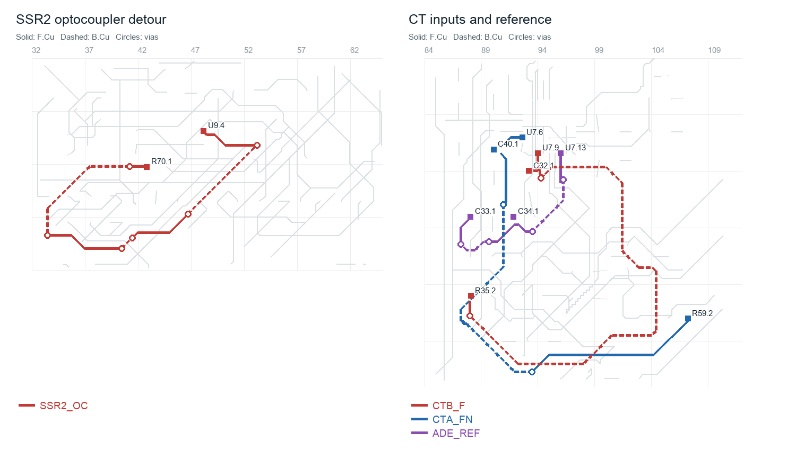

# Pre-order PCB and product review - 2026-11-03

**Recommendation: hold the assembly order for the U2 sourcing correction and the terminal-hole correction. Resolve the J6 mating connector choice before ordering the cable parts.** After those changes, this is a reasonable small engineering-prototype run for a ceramic kiln controller. The present routing is serviceable but substantially short of optimal. A clean DRC is not evidence that the assembled product has been qualified.

Reviewed rev B.5 at commit `6b4de0e`, with the current working-tree files. Board SHA-256: `a6b2de37ecca3f6ffb7fcb54d766ef9a851e52e876ea077c403ea32f1306db10`. Existing edits to CLAUDE.md, Makefile, route.py and the touchscreen specification were preserved. **This review changes no schematic, board, BOM, CPL, Gerber or firmware file.** Scratch experiments are identified below.

The intended system evaluated is the documented 24 V HDR-15-24 supply, door-mounted PCB, MSP4021 resistive-touch display, external antenna, isolated DC-input SSRs, ungrounded K-type probes and a separate mechanical high-temperature cutoff/contactor. Different probes, display clones, supplies or mains switching modules need their own compatibility checks.

## Findings that affect the order

### 1. P1 - U2's ordered silicon does not support the regulator analysis

The schematic and BOM order **JSMSEMI TLV1117LV33DCYR, C48937499**. The design notes and datasheet manifest instead rely on **TI's** TLV1117LV. The schematic's actual sourcing URL correctly points to the JSMSEMI sheet; the analysis did not follow it. These are electrically different devices despite the identical part-number text.

The exact JSMSEMI datasheet, downloaded and visually inspected, specifies:

| Parameter | JSMSEMI, ordered | TI, used in the design analysis |
| --- | --- | --- |
| Dropout at 500 mA | 1.05 V typical, **1.25 V maximum** | 230 mV typical |
| Dropout at 1 A | 1.10 V typical, **1.30 V maximum** | 455 mV typical, **700 mV maximum** |
| Quiescent current | 5 mA typical, 10 mA maximum | 50 uA typical, 100 uA maximum |
| Output-stage description | Bipolar pass stage; example uses electrolytic output capacitor | PMOS pass stage; explicitly stable with zero-ESR ceramic capacitors |

At 4.35 V on a USB-only +5V rail, the JSMSEMI maximum-dropout figure gives only about **3.10 V at 500 mA**, before additional path loss. Its output accuracy is specified from 4.75 V input. The 3.68-4.32 V power-mux changeover range is also incompatible with the assumed headroom. The fitted ceramic-only output network has no equivalent stability assurance in the JSMSEMI document. This is a specification mismatch, not a prediction that every board will fail on a nominal 5 V bench supply.

**Action:** specify **Texas Instruments TLV1117LV33DCYR, C15578**, or explicitly qualify another regulator against dropout, ceramic stability and thermal requirements. TI C15578 is listed by JLCPCB for Economic and Standard assembly. It is the same nominal SOT-223 pinout, so this correction need not change copper. Update the schematic sourcing fields, gen_jlc sourcing table, datasheet mapping and assembly outputs. **Re-derive the CPL rotation/origin for the replacement LCSC code**; the present U2 correction belongs to the JSMSEMI library part and must not be copied by package name.

The manifest's current "32/32 datasheets present" result cannot catch this: its mapping is keyed by Value rather than manufacturer plus orderable code. LED1's cached generic WS2812B sheet also needs checking against the fitted V5/W variant before using it for threshold guarantees.

Sources: [JSMSEMI exact datasheet, pp. 1-4](https://datasheet.lcsc.com/datasheet/pdf/e987a503b2a4a3c1ac561f2e836cc1d6.pdf?productCode=C48937499), [TI datasheet](https://www.ti.com/lit/ds/symlink/tlv1117lv.pdf), [TI part at JLCPCB](https://jlcpcb.com/partdetail/TLV1117LV33DCYR/C15578).

### 2. P1 - The actual screw terminals recommend larger holes

**J2/J3/J4/J8/J9/J10/J11/J12: 22 pins total.** All use Phoenix MKDS library footprints with **1.30 mm drills**, but the assembly BOM specifies KANGNEX WJ500V parts. The manufacturer's WJ500V drawing specifies **1.50 mm PCB holes** for 0.90 x 0.80 mm rectangular leads. The nominal lead diagonal is 1.204 mm, leaving only 0.096 mm of total diametral clearance in a nominal 1.30 mm hole, before lead and finished-hole tolerances.

This does not establish that nominal samples cannot be inserted. It establishes that the footprint does not follow the selected supplier's land pattern and has little assembly margin. The placement checker fits **pad centres**, so its pass cannot validate drill diameter.

**Action:** use a project footprint for the actual KANGNEX part with the recommended 1.50 mm holes, or procure the actual Phoenix parts for which the current footprints were made. The existing 2.60 mm pads leave a generous **0.55 mm nominal annular ring** with 1.50 mm holes. On a scratch copy I changed all 22 holes, refilled zones and reran KiCad DRC and the independent drill-clearance check: **0 violations, 0 unconnected; minimum drill web still 0.300 mm**. Thus the recommended correction is feasible without moving the connectors in that trial. Apply it through the schematic-owned footprint workflow and rerun the full release checks before exporting.

Source: [KANGNEX WJ500V family customer drawing](https://datasheet.lcsc.com/datasheet/pdf/5a3d038c44f6e3872ef57456c5bdf975.pdf), linked by the supplier for both [C8465](https://www.lcsc.com/product-detail/Terminal-Blocks_WJ500V-5-08-2P_C8465.html) and [C42377749](https://www.lcsc.com/product-detail/C42377749.html).

### 3. P2 - J6 is a different connector construction from its render and shopping list

The BOM orders **CJT A2547WV-6P, C239381**, while the footprint/model and mating shopping list describe Molex KK-254. The CJT drawing shows a **shrouded 17.78 mm-wide, 11.70 mm-high wafer**, explicitly mating with CJT A2547 housings. It is not the open friction-ramp wafer shown by the KiCad model. The Mouser list orders **Molex 22-01-3067** for it.

Pitch and pin-centre agreement do not establish housing, polarizing-rib, latch or engagement compatibility. I cannot sign off that mixed mating pair from the available drawings. J5 also mixes an XD-2510 header with a Molex mating housing; its open-ended construction is more forgiving, but it is still an unqualified mixed-vendor pair. J7's board header is already genuine Molex and has the expected matching housing.

**Action:** either use the genuine Molex 22-27-2061 at J6 and 22-27-2141 at J5, with their matching cable housings, or source the connector manufacturers' own mates and terminals. For CJT J6, the family document identifies the A2547H housing and A2547 terminal families. Confirm the exact variant, polarity and crimp tool before buying the loom. A physical sample mating check is preferable to treating "2.54 mm" as a mating specification.

Sources: [CJT A2547 family drawing, PDF p. 19 / printed A-257](https://datasheet.lcsc.com/datasheet/pdf/479e2ab7db05ed5012b5b403b6cf1aa8.pdf?productCode=C239381), [J6 supplier listing](https://www.lcsc.com/product-detail/C239381.html), [XD-2510 family drawing](https://datasheet.lcsc.com/datasheet/pdf/bc0050d6e74d1cbc5765ef07ac179590.pdf?productCode=C17700994).

## Electrical robustness and product behaviour

### 4. P2 - D18 is not a complete protection solution for the button GPIOs

The newly added ESDA6V1-5SC6 connects directly to all five J6 GPIO lines, with no series resistance between the terminal and ESP32. Its exact TECH PUBLIC sheet specifies **6-9 V breakdown at 1 mA**, and **11 V / 14 V clamping at 4.5 A / 10 A**. These are well above the ESP32 input supply range. Consequently the MCU's own clamp can conduct before the external suppressor avalanches. The array's advertised ESD survival rating does not establish survival of the MCU behind it.

**Action:** add a defined residual-current limiting path, normally modest series resistors at the MCU side of the connector clamp, or choose a protection topology coordinated with the 3.3 V GPIOs. These are slow switches, so a resistor/RC costs no meaningful signal bandwidth. The design note says routing attempts prevented fitting the resistors; that explains their absence but does not qualify the resulting circuit. A bench ESD test is still needed for a product claim. For an enclosed first prototype with short internal button wires, this is a manageable limitation; it deserves correction before a robust field product.

Source: the fitted [TECH PUBLIC datasheet, p. 2](https://datasheet.lcsc.com/datasheet/pdf/6fa3bd67d2798839eb826e011504c0a5.pdf?productCode=C2827672), visually inspected because its PDF text layer is empty.

### 5. P2 - CT and reference routing still needs a local placement pass

The capacitors now sit nearer U7 than in the October review, but the finished copper still contains long sensitive nodes:

| Net | Summed copper | Vias | Significance |
| --- | ---: | ---: | --- |
| CTB_F | **46.44 mm** | 2 | Only 13.94 mm in the straight-line terminal spanning-tree comparison |
| CTA_FN | **43.13 mm** | 2 | Long return from R59 to the U7/filter region |
| ADE_REF | **19.54 mm** | 4 | Internally generated precision reference feeding its bypass capacitors |
| ADE_VINTD | 9.42 mm | 2 | Internal regulator bypass node |

Lengths are the sum of the whole net's branches, not necessarily a single pin-to-capacitor path. The local C31/C32/C40 positions are improvements; do not move those capacitors back toward J12 to make a visual pair. Instead bring the **series filter resistors** into the U7 capacitor cluster and route R-C-input as a compact circuit. Keep the burden/connector path separate. Give the reference and internal supply bypass paths short, direct routes before routing digital signals around them.

The board can plausibly measure kiln current in its present form, but these routes increase pickup susceptibility and make low-current accuracy more dependent on the assembled-board test. Prioritize this above cosmetic SSR or UART routing if copper is being revised before the first order. See the measured plots and CSV under `review-2026-11-03/`.

### 6. P2 - The SPI reference-plane problem remains

The stack is **F.Cu / GND / +3V3 / B.Cu**. The three shared SPI nets alone have **37 signal vias**: SCLK 13, MOSI 10, MISO 14. Changing from front to back changes the nearest reference plane from ground to power. Added ground stitches help the coplanar return but do not connect the two reference planes. Transfer capacitors help locally; they do not make every transition equivalent to a continuous ground reference.

Keep R72/R73 source damping and the short source-side escapes. For the next layout pass, reserve the SPI trunk and branch corridors first and reduce crossings at U1 and the display resistor bank. A four-layer revision with ground reference adjacent to both signal surfaces is worth considering, provided 3.3 V distribution is then deliberately redesigned. Do not casually replace the current power plane and strand its connections.

For this prototype, qualify with the intended display and loom: display at 40 MHz, thermocouple conversions concurrently, Wi-Fi transmitting, both SSR controls switching, including reset and power transitions. Probe at the receivers with a short ground connection. The documented 20 MHz display fallback is useful. There is no basis here for declaring 40 MHz plus an arbitrary cable length guaranteed.

USB is a better result: both traces have **zero vias** and the existing pair checker passes. Connector-to-MCU path lengths are 25.09 / 22.57 mm, with 2.52 mm skew. For USB Full Speed, further matching or paid controlled impedance is a poor first-run optimization compared with the findings above.

### 7. P2 - Tighten the power/fault claims and qualify load corners

The 24 V path, reverse-polarity arrangement, true buck-priority mux, 60 V channel P-FETs and high-side watchdog cutoff are coherent. The old grounded-return bypass problem is resolved in this topology. The component changes to the buck input capacitors, catch diode and output electrolytic are useful improvements.

Three limits still matter:

- **Input protection:** SMAJ30A's specified high-current clamp is 48.4 V; XL1509 has a **45 V absolute maximum** and a 40 V operating ceiling. The notes' interpolation from the TVS breakdown/clamp points is an engineering estimate, not a guaranteed clamp envelope. A TVS is also not guaranteed to fail short as the fault-clearing mechanism. Keep the specified current-limited, in-box supply; remove claims that F1/D8 universally protect arbitrary overvoltage sources. A broader input specification needs coordinated surge/OVP hardware or a higher-voltage regulator. Q8's forward-conducting body diode means its 30 V rating should not simply be compared with the positive input rail as though it were an off-state series switch.
- **USB-only load:** CC pins have Rd resistors but no advertised-current measurement, and there is no display load shedding. The notes budget roughly 0.8 A on the 5 V rail in use, above a traditional 500 mA USB 2 port budget. Do not promise full operation on every laptop/hub/cable. Qualify the actual current and cable drop; use the 24 V supply alongside USB for normal powered development. Correcting U2 is still necessary.
- **Thermal and stability qualification:** measure 5 V ripple, startup overshoot, load-step response, U11/L1/U2 temperatures and uninterrupted operation at the specified 50 C in-box ambient. A chosen electrolytic with specified impedance is better evidence than an unspecified general-purpose capacitor, but LM2596-family analogy does not prove the XL1509 loop stable with this assembled network. With TI U2, a 500 mA 3.3 V load dissipates about 0.85 W; additional header current must be included. Test a header short while verifying the main 3.3 V rail remains usable, rather than assuming U13's current limit alone proves isolation of the fault.

Retain the documented 1 A 5 V rail ceiling and the derated shared SSR-load budget. Two ordinary SSR inputs fit comfortably; multiple power contactor coils require a separate budget. Do not enlarge F1 to hide a thermal or load-budget problem.

The external AUX_VP feed also consumes the installed PSU's capacity even when it bypasses F1. At 50 C, 0.63 A supply capacity minus the notes' 0.29 A maximum buck demand and approximately 0.04 A for SSR inputs/indicators leaves only **0.30 A before margin**. At the documented 60 C derating it leaves about **0.14 A**. The enclosure guide's "roughly 20" coils is therefore not valid for twenty simultaneous 20 mA coils alongside the controller. Publish one combined configuration budget. U6's 500 mA single-channel headline is likewise not a simultaneous three-channel board rating; qualify Darlington dissipation and 3.3 V drive with the actual loads.

### 8. P2 - Watchdog capability and commissioning instructions need precise wording

U10's edge-retriggered architecture, default pull-downs and separate Q9 cutoff are sensible supplementary protection. However, the **1.3-3.1 s** window is extrapolated from the one-shot's timing anchor, component tolerances and leakage. The datasheet does not give that whole bound at the fitted 1 Mohm / 2 uF combination. Treat it as a design estimate until characterized over rail and temperature, including cessation of pulses high, low and high impedance.

Also distinguish **last kick to cutoff** from **supervision failure to cutoff**: the previous safety heartbeat can remain eligible for approximately another 900 ms before further kicks stop. Test a safety-task-only stall separately from a complete MCU halt; the one-shot estimate alone is not the complete failure-response time.

R22 is still a **100 kohm** pull-up on Q9's gate, inherited from the old topology. Consider reducing it to the existing **10 kohm** BOM value after checking the gate network across the input range. That gives more margin against Q7 off-state leakage and board contamination, at small static current cost and no new BOM line. This is a robustness improvement, not a demonstrated unintended turn-on in the current board.

Correct `docs/bench-smoke-test.md` before using it:

| Current instruction | Required correction |
| --- | --- |
| Q8 measurement identifies J4.1 as VIN_P | J4.1 is now downstream of Q9 and Q5 and should be off at idle. Probe Q8's output/source or U11 VIN for the protected input rail. |
| R20's "non-ground pad" / SSR2_GATE should be below 0.3 V when off | Neither end of R20 is ground now. With SSR_24V live, an off Q6 has gate approximately equal to its source, near 24 V. Measure **VGS approximately 0**, or use SSR2_CTRL as the low-voltage control observation. |
| A live idle OUT indicates Q9 shorted or SJ2 bridged | Q9/SJ2 enable the shared rail; they do not by themselves command a healthy channel on. Separate cutoff faults from channel-switch/opto/control faults. |
| TP9 tied to 3.3 V through 1 kohm positively forces the opto on during RESET | R6 adds 220 ohm, leaving only about **1.6-1.7 mA** LED current, below the 5 mA condition used to guarantee the opto's CTR. Establish a positive control with a defined test current and safe MCU pin ownership; otherwise an off SSR can be a false pass. |

The watchdog cannot turn off a failed-short mains SSR. It also does not gate AUX1-3. An independent temperature-limit path that interrupts element power, typically a separate limiter operating a contactor or a suitably rated direct-acting cutout, remains necessary. The current PCB has no independent analog temperature-limit channel. Gas purge/flow safety must not be inferred from routed but undriven expansion pins.

The root schematic still contains old switched-return/always-live-terminal notes, and the enclosure guide still offers a no-contactor configuration. Update those release instructions to the actual high-side topology and an explicit independent heater-disconnection requirement. The PCB architecture can be retained while correcting these system instructions.

### 9. P2 - J11 fault tolerance relies on the MCU's unspecified internal clamp

The 100 kohm series resistors are a useful improvement, but the 30 V terminal TVSs intentionally do not conduct on a 24 V miswire. At +29 V, each 10 kohm pull-up feeds approximately **2.57 mA into +3V3**, and the GPIO path feeds about **0.254 mA if its internal clamp holds 3.6 V**. That last voltage is an assumption, not a specified continuous fault-protection function. Several simultaneous faults or an unpowered board also invalidate the assumption that the normal controller load will always absorb rail backfeed. Negative faults similarly depend on the internal lower clamp.

Use specified external clamping/fault-rated inputs if powered-sensor miswiring is within the product requirement. Test with power present, absent and transitioning, and keep the functional interface explicitly **dry contact only**. The circuit may survive the limited fault current, but the present calculations do not establish a guaranteed 24 V fault-tolerant port. [ESP32-S3 input ratings](https://documentation.espressif.com/esp32_s3_datasheet_en.pdf).

### 10. P2 - U13 lacks local input bypass and does not isolate signal faults

C55 bypasses U13's **output**. The nearest existing +3V3/GND bypass capacitor by component-centre distance is C35, **38.01 mm away**. AP2331's application circuit shows local 0.1 uF capacitors on both input and output. Add the missing input capacitor with a short plane/ground loop when revising this area, and include it in the header-short and hot-plug tests.

The header's continuous accessory allowance should be the device's **200 mA rated output**, not its 300-500 mA overload threshold. Signal lines still reach the main MCU/metering bus and their rail clamps/pull-ups, so an externally powered or shorted I2C accessory can backfeed or stall the shared bus despite U13. Define recovery and limits rather than promising complete peripheral-fault containment. [AP2331 manufacturer datasheet](https://www.diodes.com/datasheet/download/AP2331.pdf).

### 11. P2 - USB hot-plug has a remaining voltage-margin concern

C50 helps, but the design's own plausible cable model (1 uH, 0.3 ohm and 3.75 uF effective input capacitance) predicts approximately **6.9 V hot-plug overshoot**, above U12's **6 V absolute maximum**. This is an RLC estimate, not a measured waveform or a prediction for every host. It is sufficient reason to keep this qualification open. The SRV05-4 rail clamp does not precisely limit VBUS below 6 V, and a lumped ESD charge-sharing calculation does not include the first inductive voltage peak.

Measure directly at U12 VIN2 with representative hosts/cables and both source-selection states. If the limit is exceeded, add coordinated damping/OVP or choose a more tolerant input stage; increasing capacitance alone must also respect USB inrush. These are ordinary hot-plug events, separate from a defective charger applying sustained high voltage. [TPS2116 ratings](https://www.ti.com/lit/ds/symlink/tps2116.pdf).

## Routing quality, via count and pin swaps

The inventory is **205 footprints, 189 assembled placements, 119 connected pad-net names, 2,093 track segments and 5,155.33 mm summed track length**. Everything is assembled on top. Of **623 standalone vias**, 192 are GND, 56 are +3V3 plane connections and **375 are on other nets**. The module's footprint-contained drilled EP pads are additional holes, not included as standalone vias. There are 729 drilled apertures altogether. Via sizes are 619 at 0.60/0.30 mm and four at 0.50/0.30 mm.

Do not delete ground or thermal stitches merely to lower this number. The unnecessary signal transitions are the useful target. Long net totals include branches and are not delay calculations.

| Cleanup target | Current copper / vias | Recommendation |
| --- | --- | --- |
| SSR2_OC, U9.4 to R70.1 | **43.55 mm / 6**, for pins 6.33 mm apart | Clear autorouter detour. Relocate/rotate R70 if needed and route locally. |
| CTB_F, CTA_FN, ADE_REF | See finding 5 | Prioritize placement and short analog nodes. |
| TXD0 | **109.96 mm / 15** | Slow console traffic does not require this many layer changes; reserve a simpler corridor on a layout pass. |
| WDT_KICK | **73.72 mm / 2** | Investigate cross-block GPIO exchange described below. |
| SPI_SCLK/MOSI/MISO | **146.44 / 116.65 / 134.23 mm**, 37 vias combined | Improve trunk topology and return continuity before spending effort on slow nets. |
| VIN_P and BUCK_5V | **141.77 / 18** and **170.85 / 11** | The opposite-corner buck placement creates long supply runs. Reconsider the power-block placement in a larger revision; preserve thermocouple thermal separation. |
| WDT_CT_P | **15.23 mm / 2** | Notes still describe a via-free timing route. The second timing capacitor changed that; keep this high-impedance node compact and clean. |

The general style is recognizable grid-based autorouting: many short staircase segments, repeated front/back changes and some oversized excursions around already-fixed nets. Most main routes use 0.30 mm tracks; fine escapes use 0.25 mm. Those are comfortable fabrication dimensions. Prefer a continuous corridor and fewer transitions over making every segment visually identical. Smooth small redundant jogs after connectivity is settled. Corner appearance is a much lower concern than the analog and reference-plane issues.

A targeted scratch reroute of SSR2_OC and CTB_F with the current in-house router stayed DRC-clean but reduced them only to **43.20 mm / 6 vias** and **43.72 mm / 2 vias**, respectively. That is only 3.08 mm combined length saving and **no via saving**. Re-running the same router over the same fixed placement is not the proposed optimization; the component positions and occupied corridors need to change, or the short routes need to be hand-planned.

I evaluated reassignment costs using current pad coordinates, retaining the existing SPI/USB/strap constraints. Permuting the existing five button pins, the three aux pins, the three protected-input pins or the two thermocouple CS pins provides **no improvement in the simple obstacle-free distance model**. That model is not an autorouter, but it argues against arbitrary pin swapping within those groups.

Cross-block candidates are more promising:

| Exchange | Existing U1 module pads | Reduction in combined obstacle-free terminal-tree length |
| --- | --- | ---: |
| WDT_KICK and T_CS | 29 and 5 | **15.64 mm** |
| WDT_KICK and T_IRQ | 29 and 6 | **13.81 mm** |
| WDT_KICK and ALARM | 29 and 7 | **13.41 mm** |

These are mutually exclusive candidates, not additive savings or validated routed improvements. All are general digital functions on output-capable pins for the selected quad-PSRAM module. The best candidate puts the watchdog signal on the module side facing U10, while moving the longer display signal toward the south-going corridor. Route the affected nets on a copy and compare total length, vias and the surrounding SPI impact before accepting a swap. Update U1's schematic connections, Kconfig and the canonical pin table together. Retain the dedicated native USB pair, the chosen module memory variant and the SPI source-termination arrangement. ULN2003 channels can also be exchanged, but its current input/output order already follows the nearby terminal order reasonably; it is not the first change to make.

## Connector access and enclosure fit

| Item | Review result |
| --- | --- |
| J1 USB-C | Faces the edge; present courtyard sits within the outline. No obvious cable-body obstruction on the PCB. Intended access with the enclosure door open is sensible. |
| J2/J3/J4/J8/J9/J10/J11/J12 | Wire entrances face outward and screwdriver access is from above. Body/pitch layout is plausible. Correct the drill mismatch. The selected KANGNEX body is **14.07 mm high**, so use that drawing rather than the Phoenix model for the enclosure stack. |
| J3/J8 adjacent thermocouple terminals | Nominal KANGNEX body envelopes remain separated at the 12 mm origin spacing. Keep wire/ferrule exit space outside the board. |
| J5/J6/J7 | Adjacent courtyards have about **1.37 mm and 1.70 mm** gaps. J6's actual wider shroud reduces those nominal body gaps to roughly **1.2 mm**. No demonstrated body collision, but the model and mating contract need correction. Provide vertical withdrawal access; these are not convenient to service with a panel directly overhead. |
| J14 Qwiic | Faces the lower edge, clear of J11 nominally. Provide cable and strain-relief clearance beyond the outline. It is an internal low-speed expansion port, not a long industrial I2C cable port. |
| U.FL | Accessible on the top of the selected module. Route and secure the pigtail before closing the enclosure; do not use the tiny RF connector as strain relief. External antenna is required for the proposed steel box. |
| H1-H4 | Correct 90 x 90 mm mounting grid; deliberately grounded. Use the specified compact M3 hardware envelope, conservatively <=7 mm OD at the PCB, and check actual standoff/washer bodies. A bare-hole clearance check does not include a large washer or socket tool. |
| Display and door | The documented landscape MSP4021 pin ordering agrees with J5; the touch/clock/data connections are present. The enclosure document appropriately requires measuring the real display before drilling. The full mated-connector, wire-bend and closed-door stack is not modeled, so complete-product fit is not yet proven. |

The correct way to close the mechanical sign-off is a **1:1 board print with the actual connectors/mates and mounting hardware placed on it**, plus the real display and a closed-door loom check. Check screwdriver reach, plug withdrawal, cable bend radii and hinge strain relief. The present no-overlap result is credible for the represented footprints; it cannot substitute for those unmodeled volumes.

Product wiring should explicitly identify thermocouple polarity, J4/J9 switched-positive outputs, common board ground, J11 dry-contact-only inputs and the separate externally supplied AUX_VP. Keep SJ1 open with an external aux supply and SJ2 open in service. Use ungrounded-junction thermocouples and K-type extension wire to the cold junction. For current-output CTs, specify the exact ratio and disconnected-secondary protection; the PCB burden cannot protect a CT that has been unplugged from the PCB.

## BOM and JLCPCB cost optimization

The present export has **68 BOM rows but 61 unique LCSC codes**, with duplicate rows for the same terminals and RESET/BOOT switches. Consolidate identical orderable codes in an order-specific BOM where JLCPCB permits, and inspect the actual merged quote. The generator currently prices **68 rows x $1.53**, although there are only 61 distinct physical part types. Do not assume this means a guaranteed $10.71 saving: JLC may already merge those rows in its matcher. The estimate needs to distinguish CSV rows from chargeable feeder setups.

**Keep Standard assembly for the first complete build unless a real quote justifies extra manual work.** U1 C3013945 is still explicitly **Standard Only**, verified on JLCPCB's current page. Omitting through-hole assembly alone therefore does not unlock Economic. Hand-fitting U1 and the through-hole parts could change the tier, but introduces assembly effort and module EP-process questions on the first run. C46's present Panasonic part is no longer the old Standard-only part, so the README's instruction to hand-fit both U1 and C46 is stale.

Current published assembly prices are $25.56 setup, $8.21 stencil and $1.53 feeder loading per Basic/Extended line on single-sided Standard, versus $8.18 / $1.53 / $3.07 per Extended line on Economic. Hand-solder labour is $3.58/order plus $0.0164/joint at this quantity tier. These are fee inputs, not a delivered quote; the price list also includes fixtures and leadless-package inspection. The generator's **$137.81** is only its listed setup/stencil/feeder subtotal.

Practical choices, in order of value:

1. **Correct U2 rather than economizing on the wrong silicon.** A manufacturer match matters more than a small unit-price difference, and TI remains in the same assembly tier.
2. **Use matched connector families.** The existing low-cost KANGNEX terminals can be retained with the correct holes. Buying all-genuine Phoenix terminals is not required to solve the drilling problem. Use genuine Molex at J5/J6 if keeping the current Molex loom is preferable to qualifying mixed mates.
3. **Keep assembly on one side, 100 x 100 mm, normal through vias and standard 1.6 mm four-layer processing.** These are already sensible choices. Retain the stated stackup and ENIG for this first QFN/SOT-583 build; quote alternative finishes later if cost matters. Do not pay for a TDR impedance-control service merely because the job file records an impedance target.
4. **Avoid filled/capped via-in-pad charges unless the assembly review finds a remaining need.** The current checker finds no signal via encroaching on SMD pads, and the prior U1/U2/U7 paste-hole issue has been addressed. Keep the U7 mask/paste web and module EP treatment in the final DFM review; inspect the actual assembly preview and leadless joints.
5. **Consolidate passive package lines only during a real layout pass.** Using one 33-ohm resistor package and one 100-nF capacitor package could remove up to two physical part types, approximately $3.06 in Standard feeder charges if charged separately. That is not enough to justify destabilizing a first-run layout by itself. Do not reduce the high-voltage input capacitors, buck electrolytic, protection, source resistors or current-sense filter simply to save placements.
6. **A reduced-feature product variant offers larger recurring savings**, particularly by omitting ADE7953/Y1 and a second MAX31856 channel if the product never uses them. For this prototype, fitting the planned circuits gives useful qualification data; do not silently depopulate expansion blocks while calling the board a complete dual-zone product.
7. **Use the quote, not generic Basic-part rules.** On this Standard order, exchanging Extended for Basic does not itself remove the per-type feeder charge. Via-count cleanup primarily improves routing/EMI and future design space; these ordinary 0.3 mm through drills are not an HDI process change.

Sources: [JLCPCB assembly price schedule](https://jlcpcb.com/help/article/pcb-assembly-price), [JLCPCB assembly FAQ](https://jlcpcb.com/help/article/pcb-assembly-faqs), [U1 Standard-only listing](https://jlcpcb.com/partdetail/3522415-ESP32_S3_WROOM_1UN16R2/C3013945), [JLCPCB fabrication capabilities](https://jlcpcb.com/capabilities/pcb-capabilities).

No authenticated JLC cart was created, no complete live BOM stock allocation was checked and no order was submitted. Catalogue presence and LCSC stock do not reserve JLC assembly inventory. Repeat the BOM match, actual per-part availability, assembly tier, rotation/polarity preview and final quote after applying the corrections.

## Will the product work for the stated purpose?

**Hardware architecture: plausible for ceramic kiln control after the sourcing/fit corrections, subject to first-board electrical and thermal tests.** The MCU memory variant matches the intended flash/quad-PSRAM configuration; the MAX31856 pin/filter/bias arrangement and independent CS nets are coherent; the revised high-side SSR arrangement restores watchdog authority over a channel switch fault; the native USB path and grounded enclosure arrangement are deliberate. No remaining board-wide connectivity error or nominal connector-body collision was demonstrated.

Cold-junction accuracy still needs an installed test: the thermocouple terminal and MAX31856 centres are about **17.3 mm apart**, so their temperature equality is an assumption under enclosure gradients. Use a reference probe through the actual operating range, then repeat with display/radio and both SSRs heating the enclosure. Specify probe hot-end rating, insulation, extension-wire alloy and polarity. A plausible ambient reading from shorted thermocouple wires is not necessarily a converter-detected fault.

**Current firmware: a single controlled thermocouple/SSR channel with navigation buttons, not yet the complete provisioned product.** The canonical pin table and implementation identify TC2, SSR2, ADE7953/I2C, touch, gas-flow input and several aux functions as routed provisions without functional drivers/policy. A configured pin is not an implemented feature. In particular, two-zone control, failed-SSR current detection and a touch-only door cannot be accepted from this PCB review. An unwired enabled lid input also prevents heating; fit the switch/jumper or deliberately configure it out for bench testing.

**Safety system:** the controller PCB is the low-voltage control portion. Confirm the independent limit/contactors, isolated SSR input-to-load barrier, branch protection, PE/door bonding and SSR heatsink/airflow design as part of the actual assembly. The enclosure's assumed 50 C ambient needs measurement with both heat-producing SSRs operating. This review is not a substitute for that assembly evidence or electrical-safety certification.

## Verification performed and release sequence

| Check | Current result |
| --- | --- |
| KiCad 10.0.7 schematic ERC, all severities | **0 violations** |
| Fresh PCB DRC, zones refilled, all enabled severities, exit-on-violations | **0 violations, 0 unconnected** |
| `make pcb-check` | **Pass**, including netlist freshness/parity, GPIO map, schematic layout, drill clearances, USB pair, source fields, placement/CPL fit, silk, via-in-pad, models, sync idempotence and datasheet-presence manifest |
| Schematic/board comparison | 205 components / 607 pads, **0 mismatches** |
| Physical hole web | 729 apertures, minimum **0.300 mm** |
| Fresh BOM/CPL/hand-solder/Mouser exports | **Identical** to committed outputs |
| Fresh Gerber/drill exports vs committed | All manufacturing geometry agrees; timestamps ignored |
| ZIP vs exported manufacturing files | Pass |
| 3D render content stamp | Current board/models/flags match the stored renders |
| 1.5 mm terminal-hole scratch trial | **0 DRC violations, 0 unconnected; drill-web check passes** |
| Targeted SSR2_OC / CTB_F scratch reroute | Clean DRC; **no via saving**, only 3.08 mm combined length saving |

KiCad emitted Python/wx debug assertions during some checker runs, notably the deprecated via-width API usage. Those tools nevertheless completed successfully, and a separate fresh CLI DRC was used. The project DRC profile disables three ancillary categories (tuning profiles, footprint-filter matching and footprint/pad component-type matching); the independent netlist/placement checks provide additional coverage. DRC does not validate part specifications or mating housings, as findings 1-3 demonstrate.

Before ordering: resolve findings 1-3, apply any chosen analog/protection cleanup, then regenerate netlist/sync/fab outputs and rerun ERC plus all PCB checks. Review the final JLC assembly preview and quote for those exact files. After delivery, first power without real kiln loads, verify both power sources and switchover, test the watchdog and channels with dummy loads using corrected instructions, then qualify maximum load/temperature, sensor noise with display/Wi-Fi active, real connector fit and the independently protected kiln assembly.

The remaining uncertainty is physical evidence: no board exists yet; there was no oscilloscope, temperature-chamber, surge/ESD, mated-harness or completed-enclosure test. The analysis does not claim global routing optimality, guaranteed timing from extrapolated bounds, or production readiness from a zero-error DRC.

Reproducible routing inventory: `python3 hardware/kicad/review-2026-11-03/measure.py`. Outputs: [inventory](review-2026-11-03/inventory.json), [per-net lengths/vias](review-2026-11-03/net-metrics.csv), [routing plots](review-2026-11-03/routing-hotspots.png). These are review artifacts, not replacement fabrication files.
